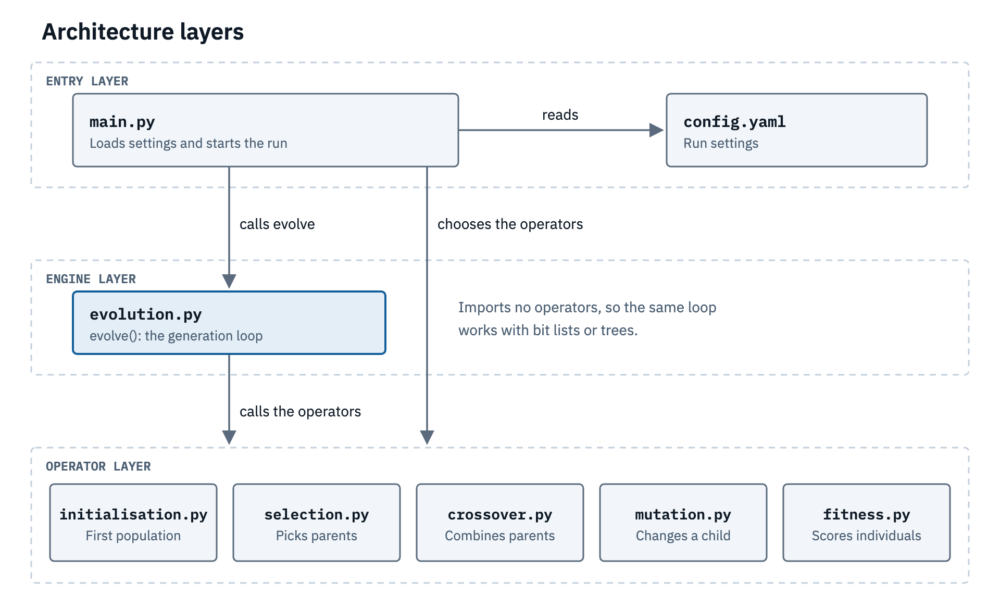
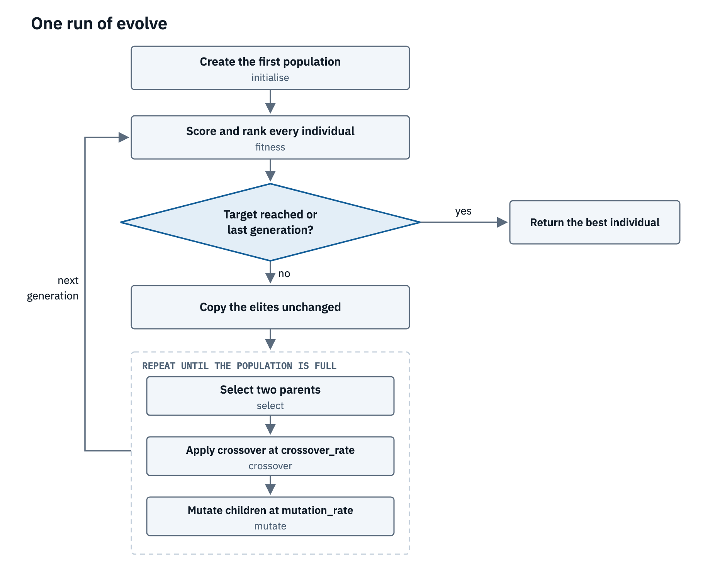
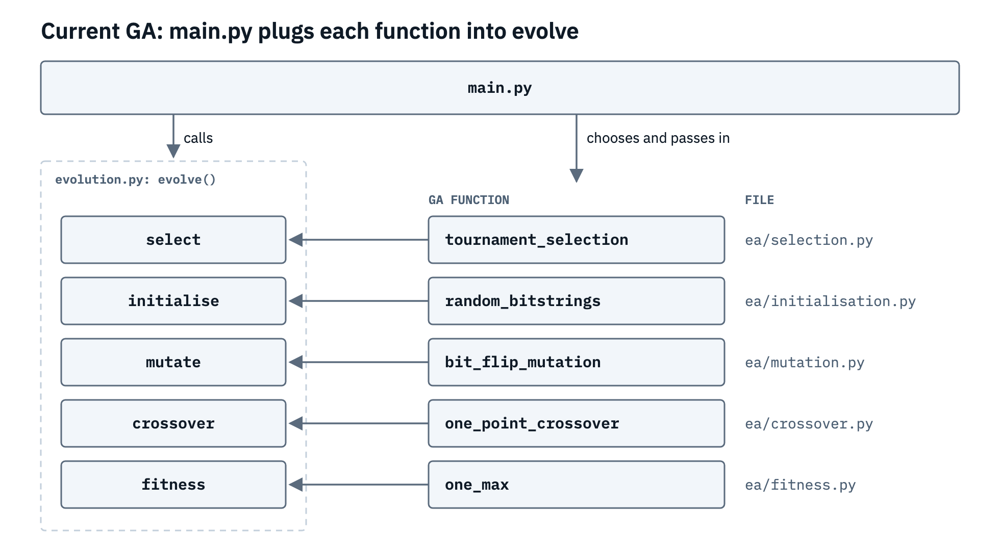
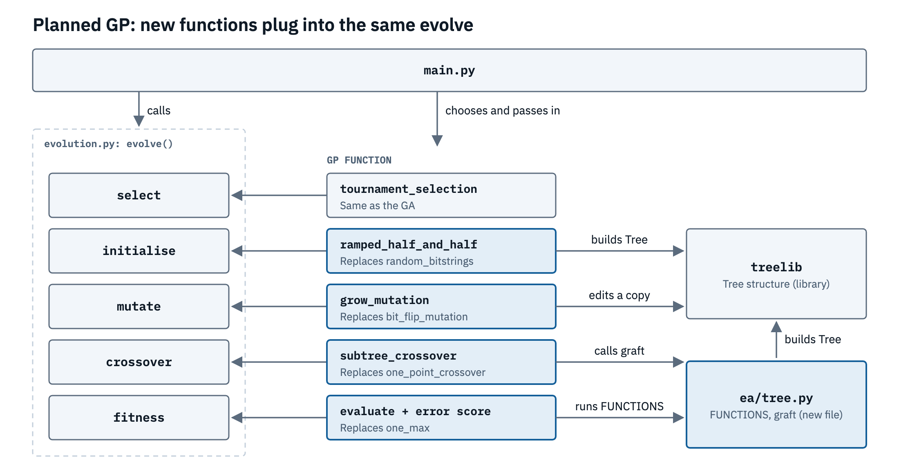
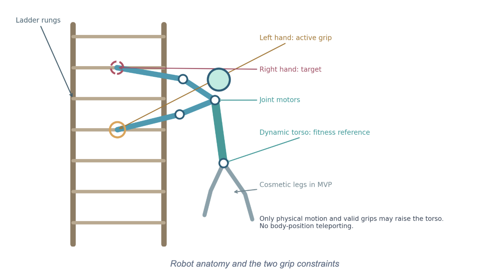

# What does our basic GA algorithm have and how do we refactor it to be suitable for GP:

Initially I created GA.py which does everything, when expanding this code so it's suitable for extension we have to think about how we actually structure this code so we can reuse necessary parts and that we can maintain this codebase for both our GA and GP code. 

Following SOLID principles we split each stage up into its own associated file, creating main.py that serves only as the entry. 

The main generic parts of any evolutionary algorithm are:

- Initialisation
- Selection
- Eliteism
- Crossover
- Mutation
- Calculating fitness
- The evolution loop

Breaking it down into these digestible parts, we then planned our codebase structure to align with this abstraction

I then looked at what the differences between GA and GP are:

| Stage | GA | GP |
|---|---|---|
| Initialisation | A population of random fixed-length arrays of bits. | Ramped half-and-half. Half full (every branch reaches max depth), half grow (branches can stop early). |
| Selection | Tournament. Pick k at random and the fittest becomes a parent. | Tournament, same as GA. |
| Elitism | Copy the best few unchanged into the next generation. | Same as GA. |
| Crossover | Pick a cut point and swap the segments between the two parents. | Pick a random node in each parent and swap the subtrees below them. |
| Mutation | Flip a bit or nudge a value at a random position. | Pick a node and replace its subtree with a newly grown random subtree. |
| Calculating fitness | Decode the array and score it with the objective function. | Run the tree on the data and measure the error against the targets. |
| The evolution loop | Evaluate → select → crossover → mutate → repeat. Evolves the best set of parameters for a problem whose structure is already fixed. | Same loop as GA. Evolves programs or expressions and finds the structure itself. Representation is a tree: function set (+, −…) for internal nodes, terminal set (x, constants) for leaves. |
| Constraints | Fixed length. | Leaves must be terminals, and there’s a max tree depth. |
| Output | A solution vector. | An executable program or expression. |

Updates required to go from GA to GP:

loads config.yaml crossover rate, mutation rate, max_tree_depth - using python dependancy manager uv - representation of population - initialize - half and half (grow and full) - ensure leaf nodes are not function nodes and are (function set and terminal set) - crossover you need to pick a node - mutation should be able to grow a tree to a single depth - ensure leaf nodes aren't function sets - fitness evaluation 

Pick a particular data structure you want to use (tree based)

https://gatree.readthedocs.io/en/latest/
Selection: Use tournament by default

For now we want to use a simpler library for as librarys like gatree will do most of the work for us and abstract a lot of the complexity from us. So the library we will be using is treelib. Its a simple tree library that we can use for our genomes.

https://treelib.readthedocs.io/en/latest/

## Architecture diagrams

We split the code into three layers. main.py picks the operators and hands them to the evolution loop, so we don't have to change the loop when we move from bit lists to trees.



This is what happens in one run. We score everyone and check if we should stop. If not, we keep the elites and breed children until the population is full, then go again.



This is our GA as it is now. Each stage has its own file, and main.py passes each function into evolve.



This is our plan for the GP. evolve and tournament selection stay the same, but we need new versions of the other operators. tree.py and treelib will handle the trees.



## Making selection extensible

At first selection was hardcoded. runner.py always used tournament selection and passed the whole `selection` block of config.yaml straight into it. That was fine with one method, but we want to try others, like roulette, without touching the evolution loop or rewriting the runner every time.

So we changed config.yaml to name the method and give each method its own block of settings:

```yaml
selection:
  method: tournament # tournament or roulette
  tournament:
    tournament_size: 3
```

In runner.py, a `SELECTIONS` dictionary maps each name to its function, the same pattern we already use for `ALGORITHMS` (ga or gp). The `selection(config)` function looks up the method and passes it only that method's settings. A method with no settings, like roulette, doesn't need a block at all. Every selection function has the same signature, `(population, fitness_scores)` plus its own settings, so evolve.py doesn't care which one it gets.

Adding a new method now takes three steps:

1. Write the function in selection.py.
2. Add it to `SELECTIONS` in runner.py.
3. Set `method:` in config.yaml.

### Roulette selection

Roulette (fitness proportionate) selection picks each individual with probability proportional to its fitness. The textbook version assumes all fitness is positive, but our GP fitness is negative error, where 0 is perfect and everything else is below zero. To make one function work for both GA and GP, we shift the scores so the worst individual scores 0 and use those as the weights. If everyone has the same fitness, all the weights are 0, so we pick uniformly instead.

We checked that it picks with the right probabilities. With scores of [-10, -5, 0] the weights are 0, 5 and 10, and over 30,000 picks we got roughly 0%, 33% and 67%, as expected.

What we noticed when comparing it to tournament:

- **GP:** roulette still found an exact fit to our points, `(x + 1)(x³ + x)`, with fitness 0.
- **GA (OneMax):** roulette got to 99 out of 100 in 50 generations, while tournament got to 100. This is a known weakness of roulette. Near the end, when everyone's fitness is close (98, 99, 100), the best individual is barely more likely to be picked than the rest, so selection pressure fades. Tournament only cares about who is better, not by how much, so it doesn't have this problem.
- Because of the shift, the worst individual in each generation can never be picked.

We're keeping tournament as the default for both GA and GP.

# Moving from GP to a real-world example

## Possible direction: evolving virtual creatures

We're considering simulating creatures and evolving them, based on Karl Sims' *Evolving Virtual Creatures* (SIGGRAPH '94).

https://www.karlsims.com/papers/siggraph94.pdf

In the paper, each creature's genotype is a directed graph. The graph describes both its body (3D blocks connected by joints) and the neural network that controls it, so the body and the brain evolve together. The creatures are run in a physics simulation and scored on tasks like swimming, walking, jumping and following a target.

This ties in with what we already have. Like our GP trees, the genotype is a structure, not a fixed-length array, so evolution finds the shape itself rather than just tuning parameters. Our evolution loop and selection would stay the same. We'd need new representation, crossover, mutation and fitness code, and a physics simulation to measure fitness.

We haven't decided yet, but it's an interesting avenue for us to go down.

## Our idea: a stick figure climbing a ladder

Instead of evolving a whole creature like Sims, we're starting with something smaller: a 2D stick figure that learns to climb a ladder.

- **The body is fixed.** We design it by hand: a torso and two arms, each with an upper and lower segment, connected by joint motors. The legs are only for looks in the first version.
- **The ladder** is a set of rungs that the hands can grip.
- **Climbing** means alternating hands: one hand holds a rung while the other reaches for the next rung up, then the body pulls itself up.
- **The GA evolves only the controller**, not the body. The controller is a hand-designed four-phase state machine, and the GA tunes its numbers (joint targets, phase durations and motor gains).
- **Fitness is how high the torso gets**, but only through real physical motion and valid grips. The body can't be teleported upwards.

The physics runs in Pymunk. A Pygame window is only for watching a run, not for scoring it.



The two papers below back up the two main choices in this design: fixing the body and evolving only the controller, and making the fitness function hard to cheat.

## Supporting papers for our design

### Fixing the body and evolving the controller

Gallagher et al. (1996), *Application of evolved locomotion controllers to a hexapod robot*.

https://www.sciencedirect.com/science/article/pii/S092188909600036X

Gallagher et al. (1996) showed that a GA evolving only the controller of a fixed, hand-designed body can produce effective locomotion. Their hexapod's body was designed by hand and never changed, and the GA evolved only the weights of its neural network controller. That was enough to produce working walking gaits.

We adopt the same split, fixing the body and evolving the controller, but apply it to a harder task (climbing, which needs grip and weight transfer) with a more constrained controller (a four-phase state machine rather than a neural network). This means we don't need Sims-style co-evolution of body and brain, which gives us a smaller search space and a cleaner experiment.

We treat this as a precedent, not proof:

- **Walking isn't climbing.** Their robot always had legs on the ground. It never had to grip, carry its weight on one hand or pull itself up against gravity, so whether our robot can climb is still our own research question.
- **The controller is different.** They evolved neural network weights. We evolve the settings of a hand-designed four-phase controller (joint targets, phase durations and servo gains). Both are a GA tuning numbers on a fixed controller structure, but ours is more constrained, which makes it easier to explain and fits our scope.
- **Sim-to-real doesn't apply to us.** Their gaits also worked on a real robot, but we stay in simulation, so we don't rely on that part of the paper.

What's new in our project is the task and the controller design, not the method.

### Guarding against evolution "cheating"

Lehman et al. (2020), *The Surprising Creativity of Digital Evolution*.

Lehman et al. (2020) document many cases where evolved agents met the letter of their fitness function while defeating its intent, often by exploiting physics-simulator bugs. More than 50 researchers contributed first-hand accounts, many of them about physics-simulated creatures like the ones we're building. Two of its categories matter most to us:

- **Misspecified fitness:** evolution optimises exactly what you measured, not what you meant.
- **Exploiting simulator bugs:** creatures use numerical glitches, such as faulty collisions or energy appearing from nowhere, to score.

We therefore defined fitness only on verified, sustained torso ascent while gripping, capped all actuator authority, and validated champions by replay. Each rule blocks a type of exploit the paper documents:

| Our rule | What it prevents |
|---|---|
| Fitness uses torso height, not hand or head | Scoring by stretching an arm up without climbing |
| Height must be held for at least 0.25 s with a grip | Jumping or flinging upward, then falling |
| No teleporting, and grips only within 0.05 | Exploiting how grips are created |
| Capped motor force and speed, and non-finite positions are rejected | Exploiting solver instability for "free" energy |
| Inspect replays, not just scores | Catching exploits that the metrics don't |

This is why our fitness function is more complicated than just measuring height. The paper suggests a simple height-based score would almost certainly be exploited.
