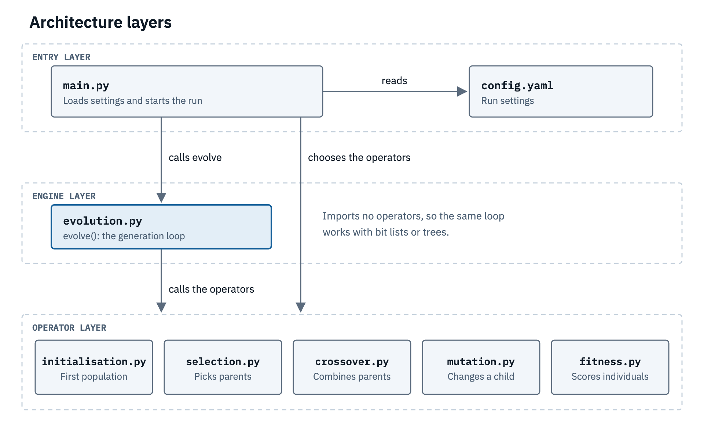
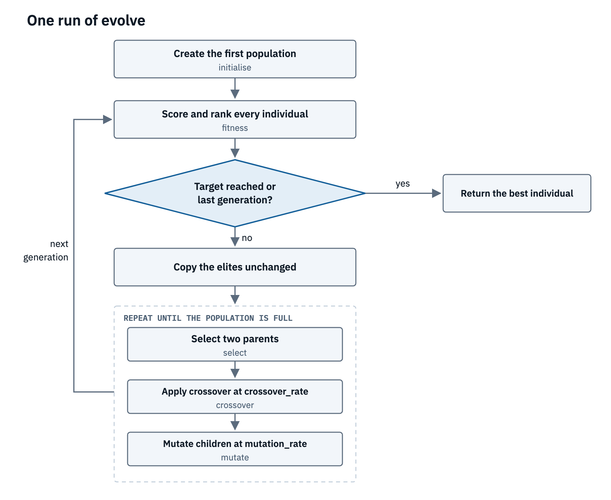
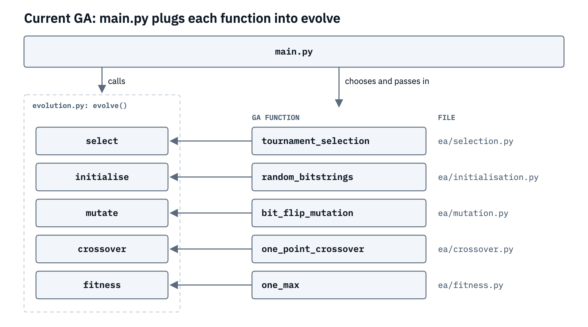
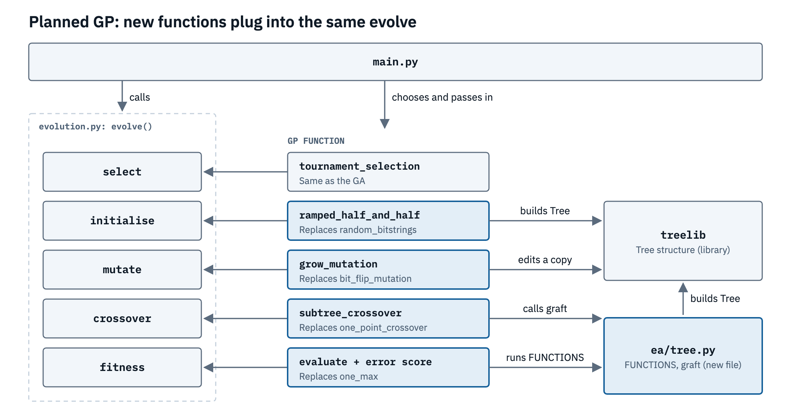

# What does our basic GA algorithm have and how do we refactor it to be suitable for GP:

Initially I created GA.py which does everything, when expanding this code so it's suitable for extension we have to think about how we actually structure this code so we can reuse necessary parts and that we can maintain this codebase for both our GA and GP code. 

Following SOLID principles we split each stage up into its own associated file, creating main.py that serves only as the entry. 

The main generic parts of any evolutionary algorithm are:

- Initialisation
- Selection
- Eliteism
- Crossover
- Mutation
- Calculating fitness
- The evolution loop

Breaking it down into these digestible parts, we then planned our codebase structure to align with this abstraction

I then looked at what the differences between GA and GP are:

| Stage | GA | GP |
|---|---|---|
| Initialisation | A population of random fixed-length arrays of bits. | Ramped half-and-half. Half full (every branch reaches max depth), half grow (branches can stop early). |
| Selection | Tournament. Pick k at random and the fittest becomes a parent. | Tournament, same as GA. |
| Elitism | Copy the best few unchanged into the next generation. | Same as GA. |
| Crossover | Pick a cut point and swap the segments between the two parents. | Pick a random node in each parent and swap the subtrees below them. |
| Mutation | Flip a bit or nudge a value at a random position. | Pick a node and replace its subtree with a newly grown random subtree. |
| Calculating fitness | Decode the array and score it with the objective function. | Run the tree on the data and measure the error against the targets. |
| The evolution loop | Evaluate → select → crossover → mutate → repeat. Evolves the best set of parameters for a problem whose structure is already fixed. | Same loop as GA. Evolves programs or expressions and finds the structure itself. Representation is a tree: function set (+, −…) for internal nodes, terminal set (x, constants) for leaves. |
| Constraints | Fixed length. | Leaves must be terminals, and there’s a max tree depth. |
| Output | A solution vector. | An executable program or expression. |

Updates required to go from GA to GP:

loads config.yaml crossover rate, mutation rate, max_tree_depth - using python dependancy manager uv - representation of population - initialize - half and half (grow and full) - ensure leaf nodes are not function nodes and are (function set and terminal set) - crossover you need to pick a node - mutation should be able to grow a tree to a single depth - ensure leaf nodes aren't function sets - fitness evaluation 

Pick a particular data structure you want to use (tree based)

https://gatree.readthedocs.io/en/latest/
Selection: Use tournament by default

For now we want to use a simpler library for as librarys like gatree will do most of the work for us and abstract a lot of the complexity from us. So the library we will be using is treelib. Its a simple tree library that we can use for our genomes.

https://treelib.readthedocs.io/en/latest/

## Architecture diagrams

We split the code into three layers. main.py picks the operators and hands them to the evolution loop, so we don't have to change the loop when we move from bit lists to trees.



This is what happens in one run. We score everyone and check if we should stop. If not, we keep the elites and breed children until the population is full, then go again.



This is our GA as it is now. Each stage has its own file, and main.py passes each function into evolve.



This is our plan for the GP. evolve and tournament selection stay the same, but we need new versions of the other operators. tree.py and treelib will handle the trees.



## Making selection extensible

At first selection was hardcoded. runner.py always used tournament selection and passed the whole `selection` block of config.yaml straight into it. That was fine with one method, but we want to try others, like roulette, without touching the evolution loop or rewriting the runner every time.

So we changed config.yaml to name the method and give each method its own block of settings:

```yaml
selection:
  method: tournament # tournament or roulette
  tournament:
    tournament_size: 3
```

In runner.py, a `SELECTIONS` dictionary maps each name to its function, the same pattern we already use for `ALGORITHMS` (ga or gp). The `selection(config)` function looks up the method and passes it only that method's settings. A method with no settings, like roulette, doesn't need a block at all. Every selection function has the same signature, `(population, fitness_scores)` plus its own settings, so evolve.py doesn't care which one it gets.

Adding a new method now takes three steps:

1. Write the function in selection.py.
2. Add it to `SELECTIONS` in runner.py.
3. Set `method:` in config.yaml.

### Roulette selection

Roulette (fitness proportionate) selection picks each individual with probability proportional to its fitness. The textbook version assumes all fitness is positive, but our GP fitness is negative error, where 0 is perfect and everything else is below zero. To make one function work for both GA and GP, we shift the scores so the worst individual scores 0 and use those as the weights. If everyone has the same fitness, all the weights are 0, so we pick uniformly instead.

We checked that it picks with the right probabilities. With scores of [-10, -5, 0] the weights are 0, 5 and 10, and over 30,000 picks we got roughly 0%, 33% and 67%, as expected.

What we noticed when comparing it to tournament:

- **GP:** roulette still found an exact fit to our points, `(x + 1)(x³ + x)`, with fitness 0.
- **GA (OneMax):** roulette got to 99 out of 100 in 50 generations, while tournament got to 100. This is a known weakness of roulette. Near the end, when everyone's fitness is close (98, 99, 100), the best individual is barely more likely to be picked than the rest, so selection pressure fades. Tournament only cares about who is better, not by how much, so it doesn't have this problem.
- Because of the shift, the worst individual in each generation can never be picked.

We're keeping tournament as the default for both GA and GP.
